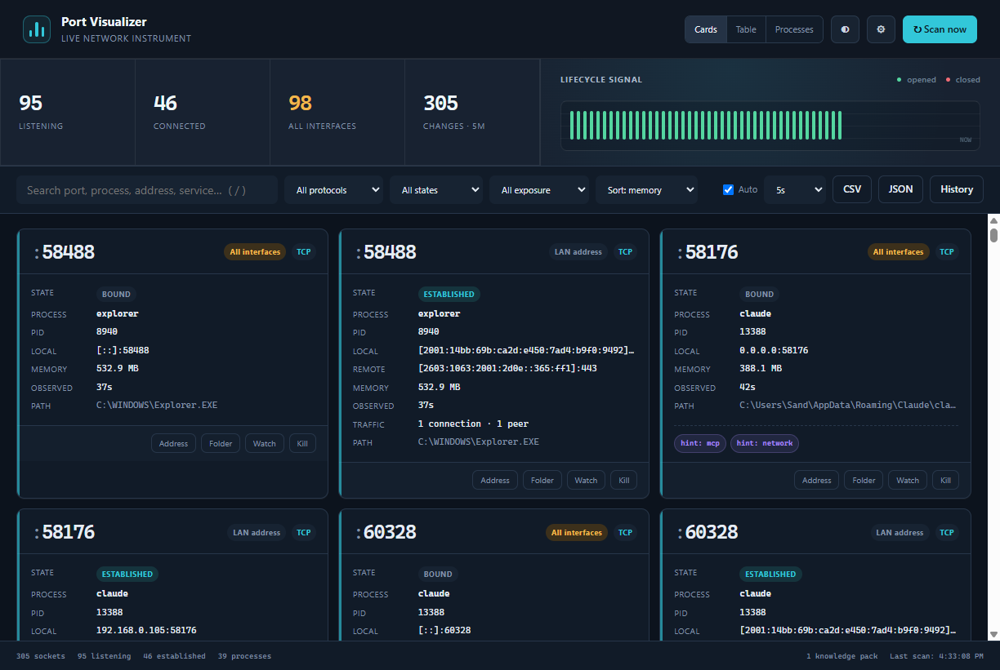
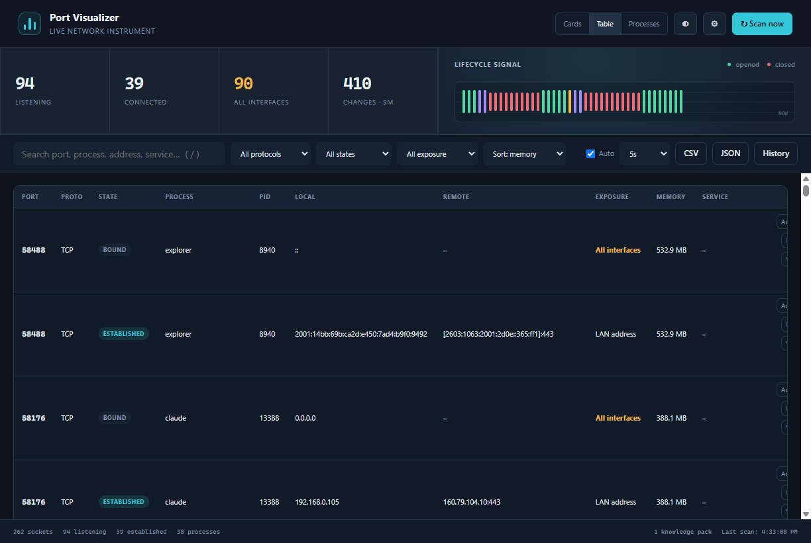
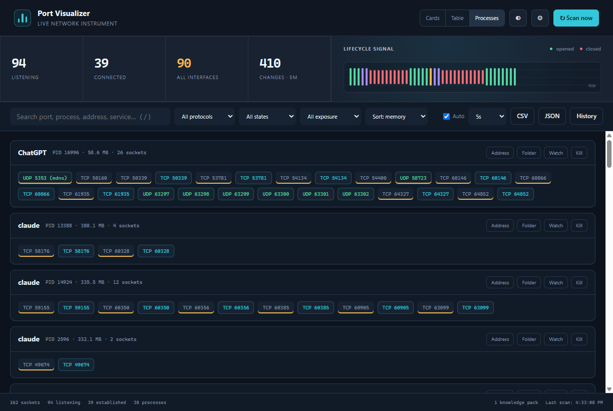

# Port Visualizer

[](https://github.com/TheSandemon/port-visualizer/actions/workflows/ci.yml)
[](https://github.com/TheSandemon/port-visualizer/releases/latest)
[](LICENSE)
[](https://github.com/TheSandemon/port-visualizer/releases/latest)

See which processes own your active TCP and UDP ports without working through `netstat` or Task Manager. Port Visualizer is a Windows desktop app for inspecting connections, tracking changes, and safely managing local processes.

[Download the latest Windows release](https://github.com/TheSandemon/port-visualizer/releases/latest)



| Detailed table | Process groups |
| --- | --- |
|  |  |

## Features

- Inspect active TCP and UDP sockets with process, PID, address, state, memory, and executable details.
- Switch between card, sortable table, and process-grouped views.
- Track opened, closed, and state-changed connections during the current session.
- Filter by protocol or state and search by port, process, address, or service name.
- Export the current filtered view as CSV or JSON.
- Open executable locations and terminate processes with confirmation, protected system PIDs, and optional elevation.
- Run from the system tray with configurable automatic refresh.

## Install

Requires Windows 10 or 11 on x64.

1. Open the [latest release](https://github.com/TheSandemon/port-visualizer/releases/latest).
2. Download `Port.Visualizer.Setup.1.0.0.exe` for the installer or `Port.Visualizer.1.0.0.exe` for the portable build.
3. Run the downloaded executable. Windows may show a SmartScreen prompt because the binaries are not code-signed.

## Keyboard shortcuts

| Shortcut | Action |
| --- | --- |
| `Ctrl + R` | Refresh connections |
| `/` | Focus search |
| `Esc` | Clear search or close a dialog |
| `1` / `2` / `3` | Cards / table / process view |

## Security model

- The renderer is sandboxed, uses context isolation, and has Node.js integration disabled.
- Process termination uses argument arrays rather than shell-parsed command strings.
- "Open location" accepts only absolute executable paths returned by the current scan.
- PIDs 0 and 4 are protected from termination.

## Development

Requires Node.js 20 or newer and npm.

```powershell
git clone https://github.com/TheSandemon/port-visualizer.git
cd port-visualizer
npm ci
npm run dev
```

```powershell
npm run lint
npm run typecheck
npm test
npm run build
```

The app uses Electron, TypeScript, and electron-vite with no renderer framework:

```text
src/main/      Electron lifecycle, scanning, process control, and settings
src/preload/   Context-isolated IPC bridge
src/renderer/  Vanilla TypeScript UI
src/shared/    Shared types, IPC definitions, exports, and port labels
tests/         Vitest unit tests
```

See [CONTRIBUTING.md](CONTRIBUTING.md) before opening a pull request.

## License

[MIT](LICENSE) © 2026 Kyle Touchet
